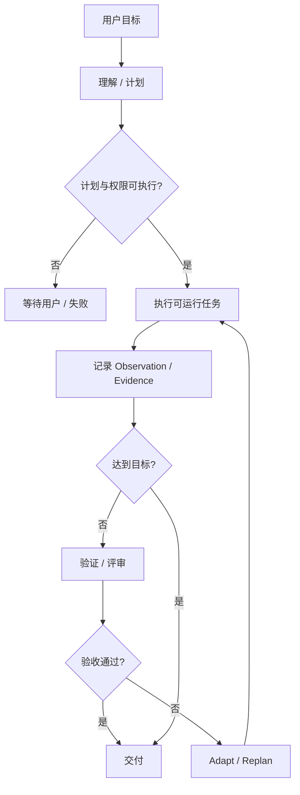
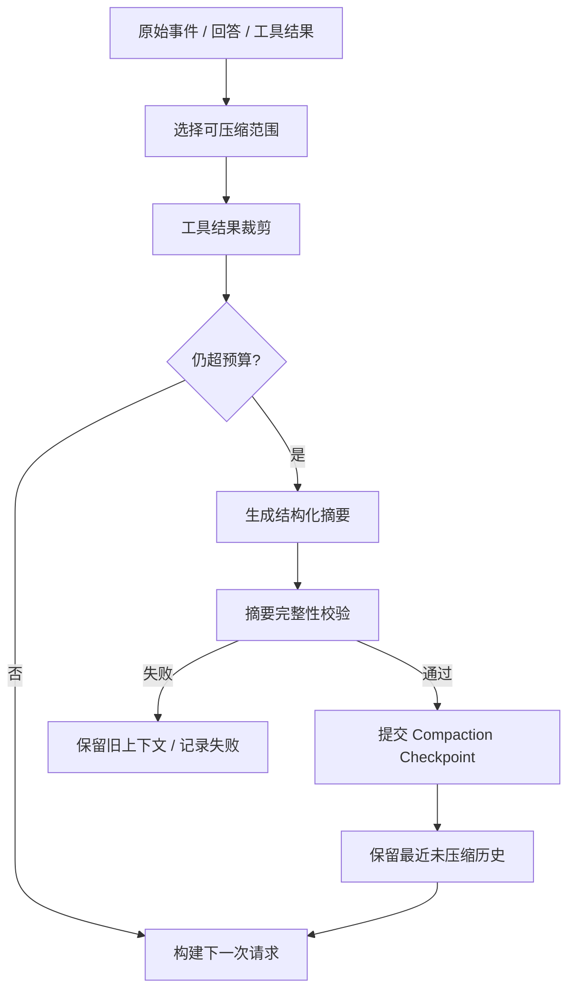

# ThinkFusion 长任务执行与上下文压缩架构

状态：设计冻结，未实施  
设计基线：`jwpttcg66/thinkfusion-ai` · `main` · `e31b6a380eea1d5df0a31f82f1f065775794a550`  
日期：2026-11-24  
实施任务书：[LONG-TASK-CONTEXT-TASK-BOOK.md](../implementation/LONG-TASK-CONTEXT-TASK-BOOK.md)  
文档集：[LONG-TASK-CONTEXT-README.md](../implementation/LONG-TASK-CONTEXT-README.md)  
契约：[LONG_TASK_CONTEXT_CONTRACTS.md](../spec/LONG_TASK_CONTEXT_CONTRACTS.md)  
存储：[CONTEXT_CHECKPOINT_STORAGE.md](CONTEXT_CHECKPOINT_STORAGE.md)  
UI：[LONG_TASK_CONTEXT_UI.md](../spec/LONG_TASK_CONTEXT_UI.md)  
测试：[LONG-TASK-CONTEXT-TEST-PLAN.md](../implementation/LONG-TASK-CONTEXT-TEST-PLAN.md)  
灰度：[LONG-TASK-CONTEXT-ROLLOUT.md](../operations/LONG-TASK-CONTEXT-ROLLOUT.md)

> 本文是架构决议，不是实施记录。实施前必须重新核对届时最新的远程 `main`；
> 代码、类型、状态机与存储接口发生变化时，先更新本文，再更新任务书。

## 结论

ThinkFusion 采用：

**持久化任务状态 + 事件日志 + 分层上下文 + 检查点压缩。**

任务状态、执行历史、模型上下文必须分开管理。不新建第三套 Runtime，
不复制 DeepSeek Harness 或 OpenCode 的整套实现。

在现有 `TaskManager`、`AgentOrchestrator`、Collaboration Engine、Journal、
Evidence、Memory 之上新增 **Context Manager**，负责模型请求前的上下文
准备、预算判断、裁剪、摘要、检查点提交与恢复校验。

## 一、审计结果

### 1. 审计基线

| 项 | 值 |
| --- | --- |
| 仓库 | `jwpttcg66/thinkfusion-ai` |
| 分支 | `main` |
| 提交 | `e31b6a3` |
| 提交时间 | 2026-11-24 02:43 UTC |
| 提交内容 | 辩论轮次由分歧收敛决定，补充继续/停止原因 |
| 本次操作 | 读取代码与文档；未改动代码 |

重点核对：

- `docs/implementation/UNIFIED-TASK-RUNTIME.md`
- `docs/architecture/COLLABORATION_ARCHITECTURE.md`
- `docs/architecture/ENGINEERING_WORKSPACE.md`
- `docs/spec/GLOBAL_MEMORY.md`
- `docs/spec/GLOBAL_MEMORY_STATUS.md`
- `desktop-agent-macos/src/main/task-manager.ts`
- `desktop-agent-macos/src/main/orchestrator.ts`
- `desktop-agent-macos/src/main/agent-manager.ts`
- `desktop-agent-macos/src/main/conversation-runner.ts`
- `desktop-agent-macos/src/main/master-agent.ts`
- `desktop-agent-macos/src/main/collaboration/runner/runner.ts`
- `desktop-agent-macos/src/main/execution/execution-pool.ts`
- `desktop-agent-macos/src/main/execution/provider-sub-agent.ts`
- `desktop-agent-macos/src/main/store.ts`
- `desktop-agent-macos/src/shared/task-events.ts`
- `desktop-agent-macos/src/shared/task-lifecycle.ts`
- `desktop-agent-macos/src/shared/task-stream.ts`
- `desktop-agent-macos/src/shared/task-view.ts`
- `desktop-agent-macos/src/shared/task-conversation.ts`
- `desktop-agent-macos/src/main/providers/types.ts`
- `desktop-agent-macos/src/main/providers/ollama.ts`
- `desktop-agent-macos/src/main/providers/openai-compatible.ts`
- `desktop-agent-macos/src/main/memory/runtime.ts`
- `desktop-agent-macos/src/main/memory/inject.ts`
- `desktop-agent-macos/src/main/memory/context.ts`
- `desktop-agent-macos/src/main/memory/recall.ts`

### 2. 已有能力

| 能力 | 现有实现 | 审计判断 |
| --- | --- | --- |
| 工程任务生命周期 | `TaskManager` | 有状态机和非法转换保护 |
| 工程执行 | `AgentOrchestrator` | 有执行治理链路 |
| 协作调度 | Collaboration Engine | 有任务分配、依赖、观察、调整 |
| 多模型执行 | `ExecutionPool` | 支持本地、云端、网页、CLI |
| 流式事件 | `TaskEvent` / `AgentEvent` | 有轮次隔离、排序、去重基础 |
| 任务持久化 | `AgentStore` | 保存任务、轮次、计划、报告、事件 |
| 会话持久化 | `Conversation` / `Message` | 保存对话记录 |
| 记忆系统 | `memory.sqlite` | 有独立存储、召回、注入、送达证据 |
| Token 统计 | `ModelUsage` / `TraceUsage` | 部分 Provider 有真实用量 |
| 请求取消 | `requestId` / `AbortSignal` | 有请求级取消基础 |
| 重启处理 | `reconcileInterrupted()` | 能识别在途任务，但当前标记为失败 |

### 3. 关键缺口

#### 缺口 A：没有统一上下文压缩

`memory/recall.ts` 是从长期记忆召回；`memory/context.ts` 是把召回结果附加到
system。两者都不是上下文压缩。

压缩要处理的是：

- 当前会话积累大量消息；
- 多轮模型调用产生大量中间结果；
- 工具执行结果越来越多；
- 工程任务不断读取代码、生成报告；
- 模型即将达到上下文窗口限制。

当前没有统一的 `ContextManager`、压缩检查点、历史摘要替换与压缩后恢复。

#### 缺口 B：事件日志裁剪不是上下文压缩

`AgentStore` 有：

- `MAX_EVENTS_PER_TASK = 800`
- `MAX_RUN_EVENTS = 5000`
- `KEEP_FOREVER` 关键事件集合
- 流式 delta 节流与合并

这是事件存储规模控制，不是模型输入上下文管理。旧事件被裁剪，不代表模型
已经获得完整摘要。

#### 缺口 C：不同入口生命周期不同

工程任务走 `AgentTask → TaskManager → AgentOrchestrator`；General/Knowledge
走 `ConversationRunner`，通过 `conversationEventToTaskEvent()` 适配统一事件，
但不伪造 `AgentTask`。

这个设计合理。长任务能力不应该强迫普通问答变成工程任务，但需要统一上下文
管理接口，让不同入口共用同一套上下文生命周期。

#### 缺口 D：模型上下文长度信息不完整

`ModelMetadata.contextTokens` 允许为 `null`：

- Ollama 可以读取实际上下文长度；
- OpenAI 兼容 Provider 当前可能返回 `null`；
- 网页通道不一定提供；
- Token usage 有的通道报，有的不报。

不能用一个固定 128K/200K/256K 套到所有模型。

#### 缺口 E：中断恢复不够细

`TaskManager.reconcileInterrupted()` 当前把 `planning / executing / verifying`
直接标记为 `failed`，要求重新提交。它避免了危险自动重跑，但还没有：

- 从最近安全检查点恢复；
- 判断上一步工具是否真正执行完成；
- 对已完成步骤去重；
- 对未完成步骤重新调度；
- 恢复后继续使用原任务上下文。

> 注：`docs/implementation/UNIFIED-TASK-RUNTIME.md` 把“重启恢复”列为已完成，
> 与当前 `reconcileInterrupted()` 的实际行为不一致。本设计以代码事实为准，
> 在任务书中单独修正这一项。

## 二、总体架构

### 1. 设计目标

| 能力 | 要求 |
| --- | --- |
| 长时间运行 | 可连续执行数十分钟到数小时 |
| 动态规划 | 根据真实执行结果决定下一步，不依赖固定轮数 |
| 并发执行 | 多模型、多工具、多个子任务互不干扰 |
| 中断控制 | 用户可停止、暂停、继续、调整 |
| 崩溃恢复 | 应用重启后能判断哪些工作已经完成 |
| 上下文压缩 | 接近模型限制时自动压缩历史 |
| 证据保留 | 压缩不丢代码位置、文件哈希、测试结果等关键证据 |
| 成本控制 | 避免重复发送无用历史、重复生成摘要 |
| 全程可观察 | 用户能看到进度、工具执行、压缩记录、恢复状态 |

### 2. 分层

```text
用户 / 工作空间
  General · Knowledge · Engineering
        ↓
Task Lifecycle / Conversation Lifecycle
  任务身份、状态、轮次、取消、暂停、恢复
        ↓
Collaboration Engine
  Planner · Participants · Adapt · Debate · CrossCheck
        ↓
AgentOrchestrator
  Approval · Grant · Tools · Worktree · Journal · Verifier
        ↓
Context Manager（新增）
  Context Builder · Budget Manager · Compaction Engine · Context Recovery
        ↓
现有 Journal / Store
  任务状态、事件、消息、检查点索引
        ↓
现有 Evidence / Memory
  证据包、代码快照、长期记忆
        ↓
Provider Adapter
  Ollama · OpenAI Compatible · Web · CLI
```

关键原则：

**Context Manager 是请求前的上下文准备层，不是新的任务运行时。**

它不决定任务做什么，不创建任务 DAG，不审批工具，不负责工程执行。
它只回答四个问题：

1. 本次模型请求需要什么信息？
2. 这些信息占多少上下文预算？
3. 是否需要压缩历史？
4. 压缩后如何保证信息完整、可追溯、可恢复？

### 3. 四种状态必须独立

| 状态 | 权威来源 | 保存内容 |
| --- | --- | --- |
| Task State | `TaskManager` / `ConversationRunner` | 当前阶段、状态、下一步、取消状态 |
| Execution State | `AgentOrchestrator` / Collaboration State | 已执行步骤、审批、工具结果、验证状态 |
| Session History | `AgentStore` / Conversation | 用户消息、模型回答、事件、执行历史 |
| Context State | Context Manager | 当前请求上下文、预算、摘要版本、压缩检查点 |

不能混成一个状态：

- 对话历史压缩了，不代表任务完成；
- 任务暂停了，不代表会话历史不能继续查看；
- 工具执行完成了，不代表模型已经看到工具结果；
- 长期记忆召回成功，不代表当前上下文已经压缩；
- 模型摘要生成成功，不代表摘要已经安全提交。

## 三、长任务执行

### 1. 不是无限循环

采用：

**持久化任务状态机 + 多轮执行循环 + 检查点驱动恢复。**



每完成一个有意义的执行单元就记录一次状态与事件：

- 一次模型分析请求；
- 一次文件读取；
- 一次代码修改；
- 一次测试；
- 一次独立评审；
- 一次协作子任务。

不要把“模型调用次数”直接当作“任务进度”。

### 2. 身份层级

保留现有 `taskId`，补强运行层级：

| 标识 | 作用 |
| --- | --- |
| `taskId` | 用户的一次长期目标 |
| `runId` | 该目标的一次连续执行过程 |
| `roundId` | 一轮规划、协作或模型分析 |
| `stepId` | 一个计划步骤 |
| `attemptId` | 某一步的一次实际尝试 |
| `requestId` | 一次模型请求 |
| `checkpointId` | 一次持久化检查点 |
| `contextId` | 一份上下文快照 |

约束：

- `taskId` 不随暂停、恢复、重规划改变；
- `runId` 可在用户明确重新启动一次运行时变化；
- `stepId` 标识计划步骤，重试不改变；
- `attemptId` 每次真正重试重新生成；
- `requestId` 必须与 Answer、Trace、Usage 的身份一致。

与现有 `TaskEventEnvelope` 的 `taskId/runId/roundId/stepId/attemptId` 相容。

### 3. 状态扩展

不推翻现有 `AgentTask` 状态机，补充必要语义：

| 状态 | 含义 |
| --- | --- |
| `paused` | 用户主动暂停 |
| `interrupted` | 应用崩溃或意外退出 |
| `budget_exhausted` | 达到任务预算 |
| `blocked` | 外部条件阻塞，等待处理 |

`awaiting_approval` 与 `awaiting_clarification` 保留，不用泛化的 `paused` 替代。

主线：

```text
created → planning → plan_ready → awaiting_approval
        → executing → verifying → report_pending → completed
```

可恢复非终态：`paused / interrupted / budget_exhausted / blocked`
异常终态：`failed / cancelled`

`interrupted` 与 `failed` 必须分开：应用重启不能把所有未完成任务都视为业务失败。

### 4. 暂停、停止、取消、恢复

| 用户操作 | 系统行为 |
| --- | --- |
| 暂停 | 不再调度新步骤；可安全中止的请求被中止；保存检查点 |
| 停止当前模型 | 只取消当前 `requestId`，任务可继续 |
| 取消任务 | 终止整个任务，清理待处理工作，记录终态 |
| 继续 | 从最近有效检查点恢复，不重做已确认完成的步骤 |
| 重新规划 | 保留已完成事实和证据，生成新的计划版本 |

沿用 Provider 的三种取消语义：

- `abort`：真正中止请求；
- `give-up`：本地停止等待，远端可能还在生成；
- `none`：无法取消。

网页通道的 `give-up` 不能显示成“模型已停止”，也不能显示成节省了全部 Token。

### 5. 安全恢复

恢复不是把上次 Prompt 再发一次：

1. 加载 Task State 与最新检查点；
2. 检查 `runId` 与当前计划版本；
3. 加载已完成步骤、审批记录、EvidenceRef；
4. 对正在执行的步骤检查实际副作用；
5. 核对工具结果与文件变更；
6. 已完成步骤标记为可复用；
7. 不确定是否完成的步骤标记为 `needs_reconciliation`；
8. 只有确认安全后才重新调度。

工程任务尤其要：

- 文件写入不能因为重启自动重做；
- Git 操作必须检查当前分支和提交状态；
- 测试区分已执行、未执行、结果未知；
- 有外部副作用的命令不能自动重复执行。

**恢复的权威依据是执行事实，不是模型摘要。**

## 四、上下文压缩

### 1. 四类信息

| 类别 | 内容 | 处理 |
| --- | --- | --- |
| A. 不可压缩权威状态 | 用户目标、约束、任务状态、审批、权限、未完成步骤、文件变更、证据引用、哈希、测试报告 | 原始保留 |
| B. 可压缩历史过程 | 已完成的模型分析、已结束讨论、已解决争议、已完成工具调用过程 | 摘要替换模型输入，原始历史保留 |
| C. 当前工作上下文 | 当前问题、最近几轮模型输出、当前待执行步骤、未解决争议、最近工具结果 | 持续更新，不过早压缩 |
| D. 外部可检索信息 | 全局/项目/Workspace 记忆、Evidence Pack、代码索引、文件内容 | 按需召回 |

原则：

- A 类不能靠摘要代替；
- B 类可以压缩，但必须保留原始历史；
- C 类不能过早压缩；
- D 类不应全部塞入上下文。

### 2. 模块划分

```text
src/main/context/
  ├── manager.ts
  ├── builder.ts
  ├── budget.ts
  ├── estimator.ts
  ├── compaction/
  │   ├── policy.ts
  │   ├── planner.ts
  │   ├── summarizer.ts
  │   ├── commit.ts
  │   └── recovery.ts
  ├── checkpoint/
  │   ├── types.ts
  │   ├── store.ts
  │   └── validator.ts
  └── adapters/
      ├── provider-context.ts
      └── tool-history.ts
```

| 模块 | 职责 |
| --- | --- |
| `manager.ts` | 统一上下文管理入口 |
| `builder.ts` | 组装模型请求上下文 |
| `budget.ts` | 计算上下文预算 |
| `estimator.ts` | Token 估算与实际用量校准 |
| `policy.ts` | 判断是否需要压缩 |
| `planner.ts` | 决定压缩哪些历史 |
| `summarizer.ts` | 生成历史摘要 |
| `commit.ts` | 原子提交压缩检查点 |
| `recovery.ts` | 崩溃恢复与摘要校验 |
| `checkpoint/store.ts` | 检查点持久化 |
| `provider-context.ts` | 不同 Provider 的上下文能力适配 |

这些是建议新增模块，不代表远程仓库已存在。

### 3. 上下文组装顺序

```text
原始用户目标
  + 系统指令 / 工具契约
  + 当前任务状态
  + 最近一次有效摘要
  + 最近未压缩历史
  + 当前执行步骤
  + 必要 Evidence
  + 相关 Memory
  + 当前问题
        ↓
Token Budget 检查
        ↓
最终 ModelRequest
```

必须保留三个边界：

- 用户原始问题不能被偷偷改写；
- 工程 Evidence 与 Memory 必须区分；
- 长期记忆不能代替当前任务执行事实。

Engineering 继续保留“记忆不是证据”；摘要必须标明哪些是已验证事实，
哪些只是模型曾提出的观点。

### 4. 压缩触发

| 级别 | 触发 | 处理 |
| --- | --- | --- |
| L1 预警 | 预计使用 65% | 准备压缩候选，优先清理可丢弃工具输出 |
| L2 后台压缩 | 75% | 不阻塞当前工作，异步生成摘要 |
| L3 强制压缩 | 85% 或剩余不足 | 提交摘要检查点，重组上下文 |
| L4 溢出恢复 | Provider 报 Context Overflow | 一次受控压缩重试 |

百分比是初始策略参数，不是既有行为，也不写死在 Provider 中。

触发条件：

```text
T_trigger = W - O - R
```

- `W`：模型实际可用上下文窗口；
- `O`：为输出预留的 Token；
- `R`：安全余量。

示例：窗口 200,000，输出预留 8,192，安全余量 16,000，则输入硬上限
约 175,808；85% 是提前压缩策略，不是模型硬上限。

### 5. 两阶段压缩

**第一阶段：工具结果裁剪（不调用模型）**

- 大段终端输出；
- 重复文件内容；
- 已完成工具的冗长返回；
- 重复模型解释；
- 已被 Evidence Pack 保存的代码片段；
- 已有结构化结果的测试日志。

示例：

```text
命令：mvn test
退出码：0
测试总数：86
成功：86
失败：0
证据：ExecutionReport / EvidenceRef
```

原始日志不能删除，保留在执行记录或证据存储中。

**第二阶段：模型摘要压缩**

摘要至少包含：

| 字段 | 内容 |
| --- | --- |
| `goal` | 用户原始目标 |
| `constraints` | 用户明确约束 |
| `completed` | 已完成工作 |
| `decisions` | 已确定决策及来源 |
| `evidence` | 关键证据引用 |
| `openIssues` | 未解决问题 |
| `currentStep` | 当前步骤 |
| `nextActions` | 后续动作 |
| `risks` | 当前风险 |
| `stopConditions` | 停止条件 |

摘要不能把猜测写成已验证事实，也不能把工具输出缺失解释成成功。

### 6. 压缩是生成检查点，不是删除历史

原始事件永久保留；摘要作为新检查点进入模型上下文。



检查点：

```ts
interface ContextCheckpoint {
  checkpointId: string;
  taskId: string;
  runId: string;
  contextId: string;

  sourceStartSeq: number;
  sourceEndSeq: number;
  sourceEventIds: string[];

  summary: string;
  summaryHash: string;

  retainedEventIds: string[];
  evidenceRefs: string[];

  modelId: string;
  inputTokensBefore: number | null;
  inputTokensAfter: number | null;

  status: 'prepared' | 'committed' | 'failed';
  createdAt: number;
}
```

`sourceEventIds` 与范围必须能回答：

- 摘要替代了哪些历史？
- 哪些历史仍保留？
- 摘要是否漏掉关键事件？
- 当前请求使用了哪个摘要版本？

## 五、压缩时机与提交

### 1. 分层执行

1. 正常执行：低于 65%，不压缩；
2. 预警 65%：识别重复内容、已完成步骤、可裁剪工具结果；
3. 后台摘要 75%：异步生成，不替换当前上下文；
4. 安全提交 85%：校验摘要、历史版本、证据；通过后提交并重建上下文；
5. Provider 溢出：受控压缩重试一次，不能无限重试。

后台摘要期间不能提前删除旧上下文：摘要基于事件 1–100，任务继续产生
101–120，只能替换 1–100，保留 101–120；依赖变化时必须重新校验或重生成。

### 2. 压缩提交状态机

```text
idle → preparing → summarizing → validating → committing → committed
异常：cancelled / failed / stale
```

`stale` 表示摘要生成期间依赖的上下文版本已变化，不能直接提交。

提交必须保证：

1. 原始历史仍存在；
2. 摘要引用范围准确；
3. 关键证据未丢失；
4. 最近未压缩历史保留；
5. 新摘要版本已持久化；
6. 提交成功后下一次请求才使用新摘要。

### 3. 每个模型独立预算

同一任务里 Planner 200K、Implementer 128K、Reviewer 64K 时，不能共用一个窗口。

```ts
interface ContextBudget {
  providerId: string;
  modelId: string;

  contextWindow: number | null;
  maxOutputTokens: number | null;

  estimatedInputTokens: number;
  actualInputTokens: number | null;

  warningThreshold: number;
  compactionThreshold: number;

  confidence: 'verified' | 'configured' | 'estimated' | 'unknown';
}
```

预算来源优先级：

1. Provider 明确提供并验证的窗口；
2. 用户或 Provider 配置的限制；
3. 模型元数据估算；
4. 无法确认时保守策略。

OpenAI 兼容 Provider 的 `contextTokens: null` 不能变成虚构默认值。Token 估算
可用于预警，但不能伪装成 Provider 实际报告值。每次请求后用真实
`usage.inputTokens` 校准；没有 usage 的 Web 通道显示未知，不写 0。

### 4. 最近上下文保留

初始策略：

- 保留最近 10%–20% 的可压缩历史 Token；
- 最少保留最近 8K Token；
- 未完成的工具调用与结果必须成对保留；
- 当前目标、权限、步骤状态、Evidence 独立保留，不进入普通摘要替换范围。

实际保留量由模型窗口、输出预留、当前步骤复杂度动态决定，不固定 15K。

## 六、与 Memory / Evidence / Journal 的关系

### 1. Memory 与 Compaction

| 比较 | Memory | Context Compaction |
| --- | --- | --- |
| 目的 | 跨会话保存稳定信息 | 控制当前会话上下文长度 |
| 生命周期 | 长期 | 当前任务或会话 |
| 输入 | 用户决策、偏好、事实候选 | 当前历史、执行记录 |
| 输出 | 记忆记录 | 历史摘要与检查点 |
| 召回 | 相关性检索 | 按历史范围与任务状态恢复 |
| 权威性 | 记忆不是证据 | 摘要不是执行事实 |

不能把每份压缩摘要写入 `memory.sqlite`，否则长期记忆会被任务中间状态污染。

### 2. Evidence 不能被摘要取代

工程关键事实由 Evidence Pack 保存：

- 文件路径、行号、内容指纹；
- Git 提交；
- 测试执行结果、执行断言；
- 文件 Diff。

摘要只引用证据：

```text
结论：修改了 Provider 上下文组装逻辑。
证据：EvidenceRef ev-001；src/main/providers/ollama.ts 289-302；sha256:...
验证：mvn test，exitCode 0。
```

模型摘要不能代替真实文件内容、测试报告或执行记录。

### 3. Journal 继续是事实来源

不新增第二套 Journal。继续使用 `AgentStore`，新增检查点记录与压缩事件。

建议事件：

```ts
type ContextEvent =
  | 'context.budget.warning'
  | 'context.compaction.started'
  | 'context.compaction.summary.ready'
  | 'context.compaction.committed'
  | 'context.compaction.failed'
  | 'context.compaction.stale'
  | 'context.recovered';
```

事件只描述发生过什么；摘要存为独立检查点，事件只引用 `checkpointId`，
避免把大段摘要重复写入事件日志。

### 4. 依赖方向

```text
Context Manager
  ├── AgentStore：历史与检查点
  ├── EvidencePackStore：关键证据
  ├── MemoryService：相关记忆召回
  └── Provider：上下文限制与实际用量
```

Context Manager 只通过现有接口获取信息；不在 `memory.sqlite` 里再建任务摘要库，
也不把压缩摘要作为普通记忆候选自动写入。

## 七、模型请求接入

在现有 `ModelRequest` 外增加请求上下文描述，不破坏 Provider 接口：

```ts
interface PreparedContext {
  contextId: string;
  taskId: string;
  runId: string;

  checkpointId?: string;
  includedEventIds: string[];
  evidenceRefs: string[];
  memoryRequestId?: string;

  estimatedTokens: number;
  contextWindow: number | null;

  compactionStatus: 'not-needed' | 'compacted' | 'degraded';
}
```

调用流程：

```text
MasterAgent / Collaboration / Engineering
        ↓
SubAgentTask
        ↓
ExecutionPool
        ↓
ContextManager.prepare()
        ↓
构建上下文
        ↓
Token Budget 检查
        ↓
需要时压缩
        ↓
ProviderBackedSubAgent
        ↓
ModelProvider.generate / stream
        ↓
Answer / Usage / Trace
        ↓
ContextManager.finalize()
```

优先接入 `ExecutionPool` 与 Provider 请求适配层，因为 Collaboration、
Engineering、Debate 都经过或可以经过这里，减少四个入口各自实现压缩。

但不能在 `ExecutionPool` 对所有请求无差别拼接会话历史。不同请求类型策略不同：
Reviewer 不应自动获得 Implementer 的全部内部讨论，只应获得目标、必要证据、
Diff 与待审查问题。

保留约束：

1. `requestId` 贯通 Answer、Trace、Usage；
2. Memory 只修改 `system`，不修改原始 `question`；
3. Web 通道保持原话输入，不强制注入 system；
4. CLI 不能假装支持 system turn；
5. `systemHash` 按实际 Provider 消息组装结果计算；
6. 不支持压缩的 Provider 不能被静默换成另一个 Provider。

## 八、UI 可观察性

在现有“对话 / 轨迹 / 统计”体系上增加上下文状态，不另建复杂操作页。

### 1. 主对话页

- 任务与执行进度：`6 / 9 步`；
- 当前步骤与状态；
- 上下文使用百分比；
- 当前输入估算、压缩后估算；
- 最近检查点编号；
- 后台摘要状态（已生成 / 等待提交 / 失败）。

### 2. 轨迹页

增加压缩事件：

| 事件 | 说明 |
| --- | --- |
| Context Warning | 达到 65% |
| Compaction Started | 生成后台摘要 |
| Summary Ready | 摘要生成完成 |
| Compaction Committed | 检查点 CP-003 提交成功 |
| Context Rebuilt | 下一次请求使用新上下文 |

点击压缩记录可查看：压缩前后 Token、被压缩历史范围、摘要内容、保留的近期历史、
引用的 Evidence、压缩模型与费用、是否降级或失败。

### 3. 统计页

| 指标 | 用途 |
| --- | --- |
| 输入 / 输出 Token | 真实消耗 |
| 压缩前 / 后 Token | 评估触发与效果 |
| 压缩次数 | 长期任务上下文压力 |
| 摘要生成费用 | 压缩成本 |
| 溢出恢复次数 | 评估预算算法 |
| 上下文估算误差 | 校准预算 |

未知值显示“未提供”，不能写 0。

## 九、异常与保护

| 场景 | 处理 |
| --- | --- |
| 摘要模型调用失败 | 保留旧上下文，裁剪非关键工具输出 |
| 摘要校验失败 | 不提交检查点 |
| 摘要期间任务继续推进 | 只压缩原始事件范围，保留新事件 |
| 压缩中应用崩溃 | 恢复旧检查点，核对未提交操作 |
| Provider 窗口未知 | 保守预算，不伪造窗口 |
| Provider 报溢出 | 一次受控压缩重试 |
| 压缩后仍超限 | 降低当前请求信息量，必要时停止并说明 |
| 工具调用与结果不匹配 | 不压缩这段不完整调用链 |
| Evidence 不存在 | 不生成声称已验证的摘要 |
| 多模型同时压缩 | 按 Context ID 与版本隔离 |
| 用户取消 | 取消可取消的压缩请求，不提交不完整检查点 |

必须防止：

1. **摘要覆盖最新事实**：方案 A 已废弃、改用方案 B 时，摘要要记录 A 被废弃，
   不能只保留两条矛盾决策。
2. **摘要改变执行状态**：摘要写“测试已通过”不等于测试真的执行过；状态只能
   来自实际执行事件与验证结果。

## 十、与 DeepSeek Harness / OpenCode 的取舍

| 能力 | DeepSeek Harness | OpenCode | ThinkFusion 建议 |
| --- | --- | --- | --- |
| 长任务执行 | Session / Turn / Step | Session Runner / Subagent | 保留现有任务生命周期，统一运行事件 |
| 事件持久化 | 事件日志 | Session 历史 | 复用 AgentStore 与现有 Journal |
| 多步执行 | Agent Loop | 工具循环 | 复用 AgentOrchestrator |
| 后台子任务 | Agent 调度 | 后台 Subagent | 复用 Collaboration Engine |
| 取消与恢复 | 明确取消原因、恢复语义 | 中断后结算工具调用 | 增加检查点恢复与副作用核对 |
| 压缩时机 | 压力检测、溢出恢复 | 后台提前摘要 | 65% / 75% / 85% 分层触发 |
| 压缩存储 | 摘要替换历史表面 | Summary Checkpoint | 摘要检查点 + 原始历史保留 |
| 工具结果处理 | 可选 Pruner | 工具历史裁剪 | 先裁剪，再模型摘要 |
| UI | 执行轨迹 | 任务与子 Agent 进展 | 延续现有对话、轨迹、统计 |

判断：

- 长任务执行以现有 ThinkFusion 执行治理为核心；
- 后台摘要借鉴 OpenCode；
- 安全压缩提交借鉴 DeepSeek Harness；
- 状态恢复以 Task、Journal、Evidence 为权威。

不复制两者的完整 Runtime。

## 十一、实施阶段

| 阶段 | 内容 | 出口 |
| --- | --- | --- |
| P0 | 审计与契约冻结 | ContextCheckpoint / Budget / Event / PreparedContext 定稿；存储兼容方案确定 |
| P1 | Context Manager 基础 | Builder / Estimator / Budget / Provider 能力适配可用 |
| P2 | 工具结果裁剪 | 大输出可裁剪且原始结果可查 |
| P3 | 摘要与检查点 | 后台摘要、校验、原子提交、失败回退 |
| P4 | Provider 请求接线 | ExecutionPool 及各入口使用统一上下文；Usage 校准 |
| P5 | 暂停、恢复、中断 | 重启不重复写操作；未知步骤标记待核对 |
| P6 | UI 与全链路验证 | 真实长任务可执行、压缩、恢复、交付 |

详细任务、依赖、验收与回滚见
[LONG-TASK-CONTEXT-TASK-BOOK.md](../implementation/LONG-TASK-CONTEXT-TASK-BOOK.md)。

## 十二、正式决议

| 编号 | 决策 |
| --- | --- |
| TF-LT-01 | 不新建第三套 Runtime，继续使用 TaskManager、AgentOrchestrator、Collaboration Engine |
| TF-LT-02 | Task State、Execution State、Session History、Context State 四种状态独立 |
| TF-LT-03 | 新增统一 Context Manager，作为模型请求前的上下文管理层 |
| TF-LT-04 | 压缩只替换模型输入中的历史表示，不删除原始历史 |
| TF-LT-05 | 工具结果裁剪优先，模型摘要其次 |
| TF-LT-06 | 65% 预警、75% 后台摘要、85% 安全提交为初始策略 |
| TF-LT-07 | 不同模型独立计算上下文预算 |
| TF-LT-08 | 摘要必须引用原始事件与 EvidenceRef |
| TF-LT-09 | 长期 Memory 不等于上下文摘要，不允许自动混写 |
| TF-LT-10 | 任务恢复以执行事实为依据，不依据模型摘要自动重做 |
| TF-LT-11 | 压缩过程、成本、前后 Token 必须可观察 |
| TF-LT-12 | 所有阶段独立 PR，未经验证不得标记完成 |

最重要的不是压缩算法本身，而是压缩之后仍然能准确知道：

- 任务做到哪里；
- 哪些事情真的做过；
- 哪些证据仍然有效；
- 下一步应该做什么。

## 十三、实施前必须确认的问题

1. `AgentStore` JSON Journal 如何容纳检查点：同文件新增 `contextCheckpoints`
   数组，还是独立 `context-checkpoints.json`？需要明确原子写、裁剪与恢复顺序。
2. `TaskStatus` 增加 `paused / interrupted / budget_exhausted / blocked` 后，
   现有状态机、UI 标签、reconcile 逻辑与测试如何迁移。
3. `runId` 当前由谁生成、何时变化；恢复后是否复用原 `runId`。
4. Provider 窗口未知时的保守默认值与 UI 显示；不能伪造具体窗口。
5. Web/CLI 通道是否参与压缩摘要；如果不参与，摘要生成模型如何选择。
6. 摘要生成是否允许使用与当前任务不同的模型；费用如何归属。
7. Reviewer 的上下文策略与 Implementer 的隔离边界。
8. 现有 `UNIFIED-TASK-RUNTIME.md` 声称 P4/P5 已完成，与
   `reconcileInterrupted()` 实际行为冲突，任务书需修正状态板。
