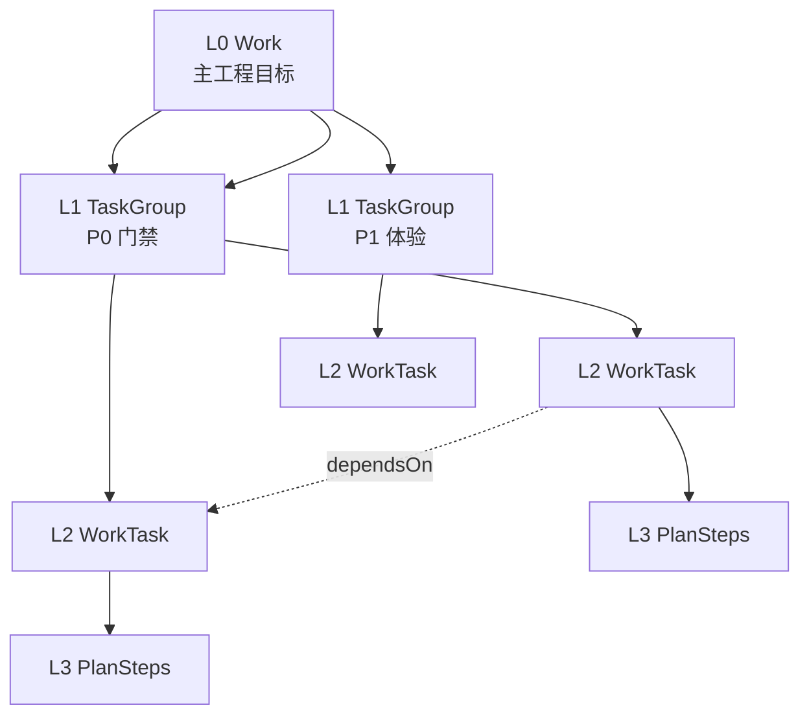

# ThinkFusion V3 分层任务分解与长任务进度管理架构

**文档版本：** V1.0  
**文档性质：** 产品设计与系统架构说明书  
**适用范围：** ThinkFusion V3 Engineering（General/Knowledge 可选轻量分解）  
**文档角色：** TDL 目标架构设计；当前实现状态见 [STATUS](../implementation/STATUS.md)。<br>
**设计快照：** 2026-11-25；当前代码状态见 [STATUS](../implementation/STATUS.md)<br>
**任务书：** [`docs/spec/V3-TASK-DECOMPOSITION-TASK-BOOK.md`](../archive/spec/task-books/task-decomposition/V3-TASK-DECOMPOSITION-TASK-BOOK.md)<br>
**相关：** [`V3-GOAL-DRIVEN-ITERATIVE-ENGINEERING.md`](V3-GOAL-DRIVEN-ITERATIVE-ENGINEERING.md)、[工程可观测性约束](../../AGENTS.md#8-工程可观测性第一原则)

> **不另建** Agent Runtime / Journal / Approval / TaskGrant / Verifier / EvidenceStore。  
> **不套**任务提示词；**不冻结**流程基线。  
> 进度必须由真实子任务状态、步骤与验收证据投影，禁止模型自报百分比冒充完成。

---

## 0. 当前实现对照（2026-11-26，先读这一节）

> 本文 §1 是 2026-11-25 的设计快照，其中「WorkTask 尚未实现」已经过时。
> 现状以本节与 [STATUS](../implementation/STATUS.md) 为准。

| 项 | 现状 |
| --- | --- |
| WorkTask | 已实现：`shared/task-decomposition.ts`，L0–L3、状态机、依赖、验收、CAS、局部重规划闭包 |
| 种树 | `seedWorkEventsFromPlan` 从计划落 `work.*` 事件；L3 归属 L2 由 `decomposition.stepIds` 决定 |
| L2 生成 | 模型给了 `decomposition` 就用；没给且任务复杂（≥2 个独立写入目录，或 ≥3 次写入）时按目标目录结构化归纳 |
| 不该拆的 | 单一交付目标（只读、单文件、单目录）允许 L0→L1→L3，不硬凑层级 |
| 归纳失败 | 标 `NEEDS_ANALYSIS`，审批可见，并取消「完全权限自动批准」——缺 L2 不当成功 |
| Goal 绑定 | `AgentTask.goalId/goalVersion` 在种树时传给每个 WorkTask；目标修订按影响闭包重打版本 |
| 子任务循环 | 每个 L2 有独立 `cycleId`（`cycle:<workId>:<workTaskId>`），L3 步骤跟随所属子任务；`shared/subtask-cycle.ts` 投影阶段与结论 |
| 失败隔离 | 步骤失败只把**依赖它的** L2 标 `blocked`，其余子任务结论照常成立；不重启整条工程 |
| 跨子任务冲突 | `detectSubtaskConflicts` 按写入目标找「两个子任务写同一文件」，报告收尾发 `cycle.subtask.conflict` |
| 集成结论 | `integrateSubtaskCycles` 按子任务计数（通过/失败/受阻/未完成），修复轮提示词只让做未通过的子任务 |
| 循环的边界 | 子任务循环有独立 `cycleId`、阶段与结论，但**不新建调度器**：仍复用主任务的执行轮次，物理上串行 |
| 进度 | 只从 `work.*` / `step.*` 投影，模型自报百分比不参与 |

## 1. 背景与缺口（对照当前 main）

### 1.1 已有

| 层 | 现状（代码事实） | 边界 |
| --- | --- | --- |
| Goal | `ConversationGoal` + GDC `EngineeringGoalView` | 目标理解与符合度投影 |
| Cycle | `WorkCycleView` / `projectWorkCycleFromEvents` | 八阶段循环**投影**，非第二套 Runtime |
| Execution | `AgentPlan.steps`（≤30）、Orchestrator、Journal、`deriveProgress` 五段 | 单份计划内的工具步骤 |
| 会话任务板 | `ConversationTeamTask` + `team.task.*` | 会话级看板：依赖/CAS/证据；**不是**工程 Work 的父子分解 |

`AgentTask`（`contracts.ts`）有 `taskId`、`maxRounds`、`maxSteps`、`runId` 等，**没有** `parentTaskId` / `childTaskIds` / 依赖图 / 验收标准字段。

GDC 说明书 §七/§八已写出逻辑对象 `WorkTask`，但 `goal-driven-cycle.ts` **尚未实现** WorkTask 投影与生命周期。

### 1.2 缺口（本架构要补的）

介于 **Cycle** 与 **PlanStep** 之间，缺少完整的任务分解层：

1. 父子任务层级与依赖图  
2. 子任务独立状态、验收标准、负责人  
3. 子任务进度汇总到主任务（真实状态计算，非百分比臆造）  
4. 子任务局部失败重试 / 恢复  
5. 以子任务为单位控制辩论与审核成本  
6. 主工作区可绘制、可随事件更新的分解进度面板（截图式清单）

### 1.3 本质区别

| | PlanStep | WorkTask（本层） |
| --- | --- | --- |
| 粒度 | 一次计划内的工具动作 | 可独立交付与验收的工程子任务 |
| 生命周期 | 随计划批准与执行结束 | 可跨多轮、多计划、多 Cycle |
| 依赖 | 计划内顺序 | 显式 DAG；可并行 |
| 协作 | 不决定是否辩论 | 复杂度/风险决定辩论与审核策略 |
| 进度 | `step.*` 事件 | 子任务状态集 + 验收证据 |

---

## 2. 四层架构（在 GDC 三层上插入 Task Decomposition）

```text
Goal Layer · 用户目标层
  最终目标、成功标准、约束、优先级
        ↓
Task Decomposition Layer · 任务分解层   ← 本文件新增
  Work / TaskGroup / WorkTask / 依赖 / 验收 / 进度汇总
        ↓
Cycle Layer · 循环决策层
  分析 → 设计 → 按需辩论 → 计划 → 实现 → 审核 → 结论
        ↓
Execution Layer · 执行层
  模型、工具、PlanStep、测试、Journal、证据
```

**关键设计：** 一个 WorkTask 可以拥有自己的 WorkCycle，但**不强制**每个子任务跑满八阶段。

| 子任务类型 | 建议路径 |
| --- | --- |
| 低复杂度（改判断条件） | 分析 → 计划 → 实现 → 自动验证 |
| 中复杂度（改调用链） | 分析 → 设计 → 有分歧才辩论 → 计划 → 实现 → 一次针对性审核 |
| 高风险（权限/数据迁移） | 完整循环 + 独立审核；重要争议必须处理 |

辩论与审核**围绕子任务**发生，父任务集成阶段只检查：子任务是否完成、冲突、目标是否达成、最终交付是否通过——不重复做已完成子任务的审核。

---

## 3. 四级对象

| 层级 | 对象 | 作用 | 与现有类型关系 |
| --- | --- | --- | --- |
| L0 | `Work` | 一次工程目标的容器（≈ 主 `AgentTask` / 主会话工程运行） | `workId` 对齐主 `taskId` 或显式 work 记录 |
| L1 | `TaskGroup` | 按功能/交付物分组（可选） | 投影用；可不落库为独立实体，先用 `groupId` 字段 |
| L2 | `WorkTask` | 可独立执行与验收的子任务 | **新建**契约；可绑定可选 `agentTaskId`（子 AgentTask） |
| L3 | `PlanStep` | 子任务内部工具步骤 | 已有 `AgentPlan.steps` |



---

## 4. WorkTask 契约（设计）

### 4.1 字段

| 字段 | 说明 |
| --- | --- |
| `workTaskId` | 唯一标识 |
| `workId` | 所属 Work |
| `parentTaskId` | 父 WorkTask；顶层为 null |
| `groupId` | 可选 TaskGroup |
| `title` / `description` | 名称与内容 |
| `dependencies` | 前置 `workTaskId[]` |
| `acceptanceCriteria` | 完成标准（可验证条目，非散文） |
| `assignedAgent` | 执行者（现有参与者 id / CLI / local） |
| `status` | 见 §4.2 |
| `priority` | 如 `P0` / `P1` / `P2`（展示与调度提示，非权限） |
| `complexity` | `low` / `medium` / `high` / `high_risk` → 驱动辩论/审核策略 |
| `collaborationPolicy` | `{ debate: 'off'\|'auto'\|'on'; review: 'auto'\|'targeted'\|'independent' }` |
| `cycleId` | 当前/最近 WorkCycle（可空） |
| `agentTaskId` | 若该子任务映射到独立 `AgentTask` 时填写 |
| `artifacts` | 交付产物引用（路径 / EvidenceRef / artifactId） |
| `progress` | **派生字段**：见 §5，不由模型直接写入权威百分比 |
| `blockedReason` | 阻塞原因 |
| `revision` | CAS 版本（对齐 `ConversationTeamTask.revision` 思路） |
| `createdAt` / `updatedAt` | 时间戳 |

### 4.2 状态机

```text
pending → ready → running → reviewing → completed
                 ↘ blocked
running → failed → ready（局部重试）或 cancelled
任意未终态 → cancelled（用户取消）
```

| 状态 | 含义 |
| --- | --- |
| `pending` | 已创建，依赖未满足 |
| `ready` | 依赖已满足，可开工 |
| `running` | 执行中（有关联 round/plan/step 事件） |
| `blocked` | 被依赖失败/外部阻塞/等待用户 |
| `reviewing` | 审核中 |
| `completed` | 验收标准满足且有证据 |
| `failed` | 失败；可局部重试 |
| `cancelled` | 取消 |

**规则：**

- `ready` 仅当全部 `dependencies` 为 `completed`（或显式豁免）。  
- `completed` 必须带至少一条验收证据（对齐 `team.task.update` done 需 evidence）。  
- 进度汇总禁止把 `running` 算成完成。

### 4.3 与 ConversationTeamTask / AgentTask 的边界

| 对象 | 所有者 | 用途 | 本层是否替代 |
| --- | --- | --- | --- |
| `ConversationTeamTask` | Conversation | 会话协作看板 | **否**；形状可借鉴（dependsOn/revision/evidence） |
| `AgentTask` | TaskManager | 执行生命周期、授权、Journal 指针 | **否**；WorkTask 可**引用**子 AgentTask |
| `WorkTask` | Work / 分解投影+事件 | 工程分解与进度 | **本层权威语义** |

禁止把 `ConversationTeamTask` 直接当成 Engineering WorkTask 混用同一张表而不声明 owner。

---

## 5. 进度：只投影，不臆造

对齐 [AGENTS.md §8](../../AGENTS.md#8-工程可观测性第一原则)：

- **权威输入：** WorkTask 状态变更事件 + Journal（`step.*` / `plan.*` / `report.*` / `review.*`）+ 验收证据。  
- **禁止：** 模型输出「已完成 60%」写入权威进度；无事件不得显示完成。  
- **主任务汇总：**

```text
completedCount = count(status == completed)
totalCount     = count(非 cancelled)
ratio          = completedCount / totalCount   // 仅展示用分数，如 2/6
```

- 当前执行任务 = 唯一或优先的 `running`（并列 running 时全部列出）。  
- 面板每一行的状态点必须能追溯到对应 `workTaskId` 与最近事件。

### 5.1 投影视图（UI 契约）

```ts
interface WorkBreakdownView {
  workId: string;
  title: string;
  summary: { completed: number; total: number; runningIds: string[]; blockedIds: string[] };
  groups: Array<{
    groupId: string;
    title: string;
    tasks: WorkTaskRow[];
  }>;
  /** 扁平列表（无 group 时用） */
  tasks: WorkTaskRow[];
  currentTaskId?: string;
  projectedAt: number;
}

interface WorkTaskRow {
  workTaskId: string;
  title: string;
  priority?: string;
  status: WorkTask['status'];
  dependsOn: string[];
  acceptanceMet: boolean;
  artifactCount: number;
  cycleStage?: string; // 来自绑定 cycle 的投影，可空
}
```

### 5.2 主工作区面板（目标形态）

对应产品示意（非已实现 UI）：

```text
工程任务 · 执行中
辩论与审核机制整改                    2 / 6

子任务
● P0：修复 auto 辩论触发          完成
● P0：审核调用门禁                完成
→ P1：核心意见去重                执行中
○ P1：辩论停止条件                待执行
○ P2：UI 进度与意见展示           待执行
○ P2：集成测试与真机验收          待执行

当前执行：P1 核心意见去重
  → 可展开：分析 / 计划 / 工具 / Diff / 测试 / 审核（真实事件）
```

能力要求：

- 点击子任务查看完整执行过程（复用 EventInspector / 活动流，带 workTaskId 过滤）  
- 显示前置依赖与 blocked 原因  
- 并行 running 分别显示  
- 主任务自动汇总  
- 暂停/恢复/中断**单个**子任务（映射到子 AgentTask 或同任务内的调度闸）  
- 用户可调优先级与顺序；范围变化时**只重规划受影响子图**，不整单推倒  

---

## 6. 事件与持久化（不另建 Journal）

新增事件类型（设计名，实施时落入 `AgentEvent` 联合）：

| 事件 | 含义 |
| --- | --- |
| `work.breakdown.created` | 分解图首次建立 |
| `work.task.upserted` | 子任务创建/字段更新 |
| `work.task.status` | 状态迁移（含 from/to、revision） |
| `work.task.blocked` | 进入 blocked 及原因 |
| `work.task.accepted` | 验收通过（附证据引用） |
| `work.breakdown.replanned` | 局部重规划（列出受影响 id） |

持久化：事件进现有 Journal；可选在 TaskManager/Store 侧缓存最新 `WorkBreakdownSnapshot` 以便快速投影，**缓存失效以 Journal 重放为准**（对齐 GDC）。

---

## 7. 协作成本绑定（与辩论/审核门禁）

| complexity | debate | review |
| --- | --- | --- |
| low | off | 自动测试/验证即可 |
| medium | auto（有分歧才开） | targeted 一次 |
| high | on（关键决策） | independent |
| high_risk | 重要争议必须处理 | independent 深度审核 |

父任务集成审核只做冲突与目标符合度，不重复子任务已通过的审核结论。

> 具体「auto 风险跳过五段/辩论」「普通任务降低方案评审轮次」等产品规则，由协作预算/门禁任务书实施；**本层提供按 WorkTask 挂载策略的挂钩点**。

---

## 8. 候选方案与取舍

| 维度 | A. 仅加强 PlanStep 分组 | B. WorkTask 投影层 + 可选子 AgentTask（推荐） | C. 新建独立 Task Runtime |
| --- | --- | --- | --- |
| 是否补充分解语义 | 弱 | 强 | 强 |
| 复用 Journal/Grant | 是 | 是 | 易重复建设 |
| 与 GDC 结合 | 难 | 自然（每任务可选 cycle） | 需双轨同步 |
| 迁移风险 | 低 | 中 | 高 |
| 违反「不另建 Runtime」 | 否 | 否 | **是** |

**推荐 B：** 契约与投影先行；执行仍走 TaskManager + Orchestrator；需要隔离时 WorkTask 再绑定子 `AgentTask`。

---

## 9. 非目标

- 不替换 Collaboration Engine / Debate Orchestrator  
- 不把 Markdown Checklist 当作权威状态  
- 不在 General 强行套满八阶段 + 全量分解（可仅目标+结论）  
- 不自动删除 worktree（见 `AGENTS.md` §5.1：用户手动清理）  

---

## 10. 验收原则

1. 有父子与依赖的 WorkTask 契约与事件，可单测重放。  
2. `WorkBreakdownView` 分数与当前任务只来自真实状态。  
3. 工程主活动区能绘制并随事件更新分解进度（形态对齐 §5.2）。  
4. 至少一条真机路径：多子任务工程中面板从 0/N → k/N，且展开可见真实步骤。  
5. 文档、STATUS、任务书一致；未实施前不得标 VERIFIED。

---

## 11. 最终定义

**理解目标 → 分解可交付子任务 → 按依赖推进 → 子任务按需循环与协作 → 真实证据验收 → 汇总进度 → 父任务集成。**  

评价标准：用户能否像工程看板一样看到「整个工程拆成了什么、做到哪、卡在哪、下一步是什么」，且每一项都有事件与证据支撑。
