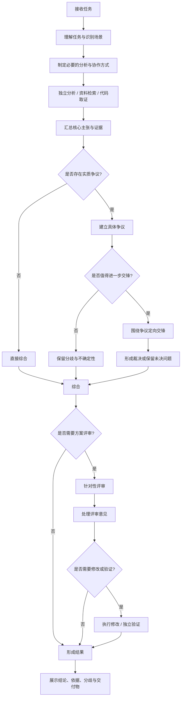
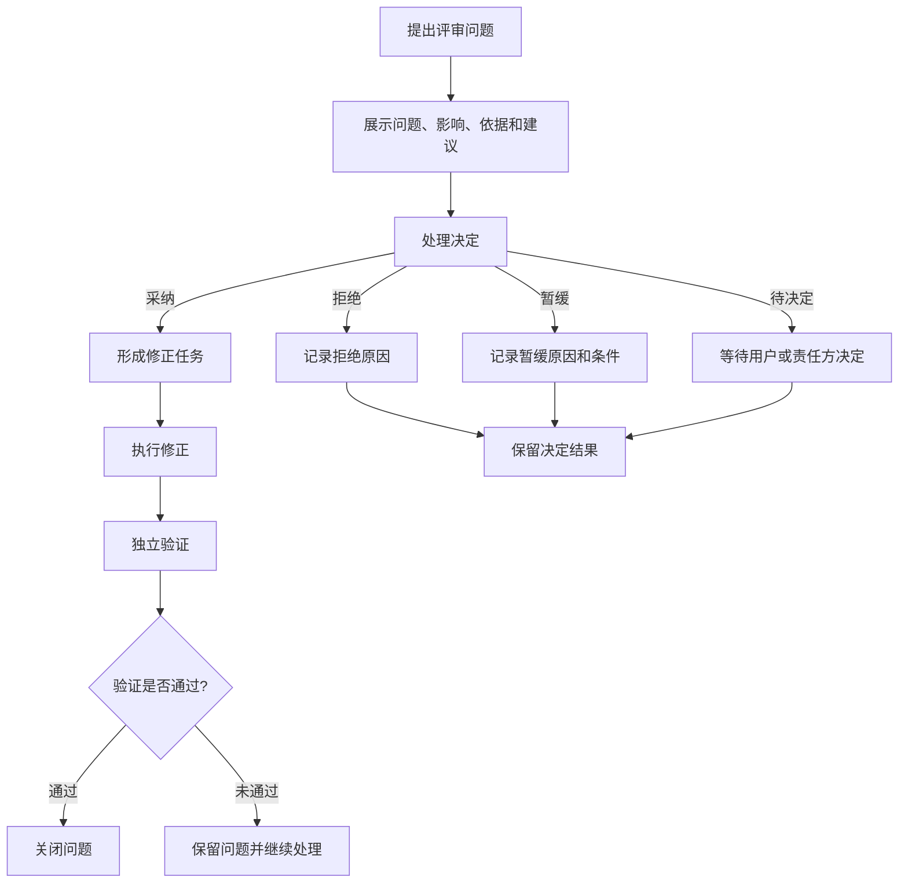
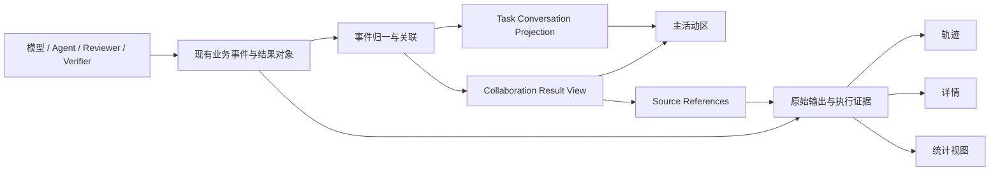

# ThinkFusion V3 主活动区与协作结果表达重构实施任务书

> 文档状态：HISTORICAL。本文仅保留历史决策/实现证据；不得作为当前实现状态、契约或验收结论。当前事实见 `docs/implementation/STATUS.md`。


版本：V1.0 · 类型：正式功能实施任务书 · 原基准：`cdc8308`（已过时）

> **任务书状态：** HISTORICAL（U0–U6 主体已合入 `main`）。  
> **后续收尾：** 见 [`V3-MAIN-ACTIVITY-U7-QUALITY-CONVERGENCE-TASK-BOOK.md`](V3-MAIN-ACTIVITY-U7-QUALITY-CONVERGENCE-TASK-BOOK.md)，基线 `main@8601fc2`。<br>
> **说明：** 不得再把本文 U0–U6 当作尚未实施清单；质量缺口（去重、来源真实性、三场景验收）由 U7 收敛。

---

## 一、任务目标

本次重构不是重新开发辩论系统，也不是单纯调整页面布局，而是要解决 ThinkFusion 当前主活动区最核心的产品问题：

1. **用户看不到真正重要的内容**：模型的核心主张、不同意见、反驳、评审理由和最终裁决被大量进度信息与状态卡片淹没。
2. **协作过程显得像强制辩论**：即使没有实质争议，也容易出现多模型重复分析、形式化质疑和不必要的交锋。
3. **评审有状态、缺内容**：界面可能显示评审开始、完成、需要修复，却没有完整展示评审者提出了什么问题、为什么、依据是什么，以及最终如何处理。
4. **过程与结论混在一起**：模型输出、工具执行、计划、评审、验证、诊断同时堆积在主活动区，用户难以理解任务究竟得出了什么结论。

本次实施必须实现：

> **以任务结论为中心，以关键意见和争议为核心，以评审与验证闭环为依据，以协作轨迹为辅助。**

最终用户应能快速回答五个问题：

- 最终得出了什么结论？
- 哪些核心观点支持或反对这个结论？
- 有没有真正尚未解决的争议？
- 评审提出了什么问题，系统如何处理？
- 修改和验证是否真正完成，有什么证据？

---

## 二、产品原则与不可违反的约束

### 2.1 Debate 是可选策略，不是必经阶段

| 情况 | 系统行为 |
| --- | --- |
| 多个模型结论一致，证据充分 | 直接综合，不启动辩论 |
| 存在表述差异，但结论不冲突 | 合并差异，不强行辩论 |
| 存在事实、数字或范围冲突 | 建立具体争议，必要时定向交锋 |
| 存在证据不足 | 标记不确定性，不制造对立 |
| 争议无法解决 | 保留分歧，说明原因，不伪造共识 |

**禁止：**

- 为了展示 Debate 功能而强制启动辩论。
- 要求每个模型都必须反对其他模型。
- 将模型数量等同于意见数量。
- 将重复分析包装成辩论轮次。
- 将系统规则判断伪装成模型裁决。

### 2.2 严格区分三类协作行为

| 行为 | 核心问题 | 主要输出 |
| --- | --- | --- |
| 方案评审 Review | 方案有什么缺陷和风险？ | 问题、影响、证据、建议 |
| 辩论 Debate | 相互冲突的主张，哪一个更站得住？ | 争议、交锋、证据、裁决 |
| 独立验证 Verification | 方案或修改实际上是否正确？ | 测试结果、执行证据、验证结论 |

三者可以先后发生，也可以按任务需要独立发生，但不能混为同一种“多模型讨论”。

### 2.3 不重建现有基础设施

本次属于现有产品表达层和协作结果投影层的重构。

不得另建一套：Agent Runtime、Collaboration Engine、Debate Runtime、Journal / Event Store、Verifier、Scheduler、Task 状态系统、重复的执行轨迹系统。

优先复用现有类型、事件、服务和组件，在现有链路上补齐数据表达和展示能力。

### 2.4 真实性约束

1. 所有关键意见必须能追溯到实际模型输出、评审结果或系统证据。
2. 不得把系统生成的进度说明当成模型意见。
3. 不得把评审状态当成评审内容。
4. 不得把未执行的测试标记为已验证。
5. 不得把未解决的争议标记为已解决。
6. 不得把 Provider 没有返回的 reasoning 内容自行补写成模型思考过程。
7. 保留模型原始输出和事件轨迹，结构化摘要不能取代原始证据。

---

## 三、目标交互模型：主活动区重新分层

主活动区不再以“谁正在运行、谁完成了、谁调用了工具”为主要阅读顺序，而是以用户理解任务结果的顺序组织。

### 3.1 主活动区五层结构

**01 · 核心结论**（默认展开）  
最终结论 / 当前阶段性结论：结论摘要、关键依据、适用范围、不确定性、待处理事项。

**02 · 核心意见与争议**（有内容时展开）  
支持观点、反对观点、不同模型的关键判断、争议双方主张、证据和回应。

**03 · 评审与验证**  
评审问题、风险等级、证据、处理决定、修正结果、验证结果。

**04 · 协作过程**  
参与者、分析阶段、任务分工、阶段进度、计划调整。

**05 · 执行证据与详细轨迹**  
工具调用、文件变更、命令、测试、原始模型输出、事件记录、诊断信息。

以上五层是信息展示层级，不是任务必须依次执行的五个阶段。

### 3.2 主活动区与独立页面的职责

| 区域 | 主要职责 | 不应承担的职责 |
| --- | --- | --- |
| 对话 / 主活动区 | 结论、核心意见、争议、评审、验证摘要 | 展示所有底层事件 |
| 轨迹 | 完整事件时间线、模型调用、工具调用、审批、执行记录 | 重新生成一份结论 |
| 统计 | Token、耗时、模型调用次数、工具次数、成本等 | 解释评审或裁决 |
| 详情展开 | 原始模型输出、完整评审文本、证据详情 | 默认占据整个主活动区 |

**设计要求：** 用户从主活动区进入轨迹或详情后，应能回到对应的任务、争议、评审意见或执行节点，不能失去上下文。

### 3.3 卡片与内容的显示规则

- 核心结论：默认展开。
- 关键意见：有实际内容就展示，不用状态占位卡替代。
- 辩论：有真实争议时展示；已完成辩论默认展示裁决和关键交锋。
- 评审：有实际评审意见时展示问题内容，而不是只显示评审状态。
- 验证：展示实际验证结果和证据；未执行时明确标记未验证。
- 协作进度：紧凑展示，不得反复插入大块状态卡。
- 原始输出：可展开，保留完整内容。
- 诊断和内部调试信息：放入轨迹或诊断详情。

---

## 四、统一任务流程：由任务驱动，而不是由辩论驱动

### 4.1 统一逻辑流程



需要强调：

- 独立分析不意味着所有任务必须调用多个模型。
- 争议识别不意味着必须进入 Debate。
- 评审不意味着每个模型都必须提出反对意见。
- 修改不意味着自动通过验证。
- 流程允许根据任务类型跳过不需要的步骤。

### 4.2 三个场景的流程差异

| 场景 | 核心流程 | 重点交付 |
| --- | --- | --- |
| General 普通知识问答 | 理解问题 → 分析 / 检索 → 比较观点与证据 → 必要时辩论 → 综合回答 | 结论、依据、不同观点、不确定性 |
| Knowledge 知识研究 | 确定主题和范围 → 拆分问题 → 多源资料 → 观点整理 → 事实冲突检查 → 必要时辩论 → 综合 | 知识结论、来源、争议、知识卡 / 知识地图 |
| Engineering 工程执行 | 理解项目 → 代码取证 → 形成方案 → 针对性评审 → 处理意见 → 审批 → 执行 → 测试与独立验证 → 交付 | 工程方案、评审意见、变更、测试和验证证据 |

三个场景共享同一套结果表达模型，但不能把三种场景强行做成同一种页面流程。

---

## 五、核心数据契约：让意见真正可见、可追溯

本次最重要的工程工作，不是增加 UI 卡片，而是把现有事件和数据整理成可展示、可追溯的协作结果。

### 5.1 统一结果投影

建议在现有 `task-conversation.ts`、`task-view.ts` 和相关类型基础上，建立统一的任务结果投影。

建议表达结构如下（概念结构，不要求照抄字段；实施时必须先映射现有类型，避免重复建模）：

```ts
interface CollaborationResultView {
  taskId: string;
  scene: 'general' | 'knowledge' | 'engineering';

  conclusion?: ConclusionView;

  keyOpinions: OpinionView[];
  disputes: DisputeView[];
  reviews: ReviewView[];
  verifications: VerificationView[];

  progress: ProgressView;
  deliverables: DeliverableView[];

  sourceRefs: SourceReference[];
}
```

核心要求：

- 一个任务只形成一份统一结果视图。
- General、Knowledge、Engineering 通过场景字段和内容差异呈现。
- 所有结构化内容保留来源引用。
- 结果视图是事件和业务对象的投影，不成为新的权威状态库。
- 刷新、恢复、重放后，投影结果应保持一致。

### 5.2 核心意见 Opinion

| 字段语义 | 要解决的问题 |
| --- | --- |
| opinionId | 这条意见的唯一身份 |
| author / participant | 谁提出了意见 |
| position | 支持、反对、补充、修正或中立 |
| statement | 核心观点是什么 |
| rationale | 为什么这么判断 |
| evidenceRefs | 有什么依据 |
| targetRefs | 针对哪个主张、方案或问题 |
| sourceRefs | 对应哪段原始输出或事件 |

不应把模型的每一段自然语言输出都变成一条核心意见。需要抽取真正影响结论的主张，同时保留原始输出。

### 5.3 争议 Dispute

一个争议必须有明确对象，而不能只是“模型 A 和模型 B 意见不同”。

| 字段语义 | 说明 |
| --- | --- |
| disputeId | 争议标识 |
| topic | 争议主题 |
| disputeClass | 事实相反、数字冲突、范围不同等 |
| claims | 双方或多方具体主张 |
| evidenceRefs | 相关证据 |
| exchanges | 质疑、回应、修正记录 |
| verdict | 裁决或无法判断 |
| unresolvedReason | 未解决的原因 |
| sourceRefs | 相关原始输出和事件 |

争议状态至少需要区分：已识别、待交锋、交锋中、已裁决、部分解决、无法判断、保留分歧。

不能把“辩论完成”直接等同于“争议解决”。

### 5.4 评审 Review

这是本次需要重点补齐的对象。当前评审投影偏重 `reviewer`、`backend`、`verdict`、`issues`、`needsFix` 等概要信息，无法充分表达评审意见。

| 字段语义 | 说明 |
| --- | --- |
| reviewId | 评审记录标识 |
| targetRef | 评审针对的方案、文件、变更或交付物 |
| reviewer | 评审者 |
| issueId | 单个评审问题标识 |
| title | 问题标题 |
| description | 问题具体内容 |
| severity | 风险等级 |
| rationale | 为什么这是问题 |
| evidenceRefs | 代码、文档、测试或其他证据 |
| recommendation | 建议如何处理 |
| disposition | 采纳、拒绝、暂缓、待决定 |
| dispositionReason | 处理决定及原因 |
| resolutionRefs | 修正或处理结果 |
| verificationRefs | 验证证据 |
| sourceRefs | 原始评审内容和事件 |

注意：以上是字段语义清单。实施前要逐项核对现有 `reviewer.ts`、事件类型和存储模型，能复用就复用，缺失的再补充。

### 5.5 评审意见的闭环状态



**关闭条件：**

- 采纳的问题必须有对应的处理结果。
- 需要验证的问题必须有真实验证证据。
- 拒绝和暂缓的问题必须保留决定理由。
- 未处理的问题不能被隐藏或自动关闭。

### 5.6 证据引用 SourceReference

所有核心意见、争议、评审和验证结果都应能够追溯到来源，至少能够回答：

- 来源属于哪一个 task / run？
- 来源事件或记录 ID 是什么？
- 来源类型是什么？
- 原始内容在哪里？
- 对应的模型、工具或参与者是谁？
- 当前结构化意见是从哪个原始内容提取或归纳出来的？

不允许在 renderer 中仅凭文本猜测来源。

---

## 六、事件到界面的完整调用链



### 6.1 必须重点审计的现有代码

| 模块 | 重点文件 | 主要任务 |
| --- | --- | --- |
| 共享数据模型 | `src/shared/task-conversation.ts` | 任务对话与协作结果表达 |
| 共享任务视图 | `src/shared/task-view.ts` | 任务状态和视图投影 |
| 事件类型 | `src/shared/task-events.ts` | 事件来源和关联关系 |
| 对话数据 | `src/shared/conversation.ts` | 对话与任务关联 |
| Debate | `src/main/debate/types.ts` | 争议、主张、交锋、裁决 |
| Debate 执行 | `src/main/debate/orchestrator.ts` | 争议驱动与结果生成 |
| Reviewer | `src/main/collaboration/reviewer.ts` | 评审意见内容与结果 |
| 协作执行 | `src/main/collaboration/runner/runner.ts` | 协作结果和事件产生 |
| 协作视图 | `src/main/collaboration/view.ts` | 协作数据投影 |
| General / Knowledge UI | `src/renderer/src/components/ConversationView.tsx` | 主活动区结构 |
| Engineering UI | `src/renderer/src/components/engineering/TaskConversation.tsx` | 工程任务主活动区 |
| 应用入口 | `src/renderer/src/App.tsx` | 页面组织和状态连接 |

### 6.2 实施时必须绘制的真实数据链路

| 展示内容 | 必须追踪的生产端 | 必须追踪的消费端 |
| --- | --- | --- |
| 核心结论 | 综合结果生成 | 主活动区结论卡 |
| 核心意见 | 模型输出 / 意见提取 | Opinion 展示组件 |
| 争议与交锋 | Debate Orchestrator | Dispute / Exchange 展示 |
| 裁决 | Debate 判定和裁决结果 | Verdict 展示 |
| 评审问题 | Reviewer | Review 展示 |
| 评审处理决定 | 审批或任务处理逻辑 | Review 闭环展示 |
| 验证结果 | Verifier / 测试执行 | Verification 展示 |
| 原始证据 | Journal / 现有事件和产物存储 | 轨迹、详情和来源跳转 |

每项至少要验证：生产端确实产生了数据；数据经过共享层正确传递；Renderer 接收到的是真实数据；页面展示没有丢失核心字段；重新加载和恢复后展示内容仍然一致。

### 6.3 投影层的权威性约束

- 业务对象和现有持久化事件仍是事实来源。
- `CollaborationResultView` 只是面向展示的派生视图。
- 不能把 renderer 本地 state 作为评审决定或裁决的唯一保存位置。
- 不能通过 UI 展示状态反向推断业务执行成功。
- 事件重复、乱序、缺失时，必须有明确处理策略。
- 结构化投影失败不能导致原始事件和模型输出丢失。

---

## 七、UI 具体改造要求

### 7.1 General / Knowledge 主活动区

目标信息层级：核心结论 → 关键观点 / 争议裁决 → 评审与验证 → 协作过程与原始输出（按需展开）。

具体要求：

- 不再将辩论、辩前综合、辩后综合、最终汇总以重复卡片堆叠。
- 已完成的真实辩论，默认显示关键争议和裁决。
- 无争议任务不显示空辩论面板。
- 多模型输出优先抽取关键观点，并提供原始输出展开入口。
- 观点必须保留参与者和来源，不能只留下系统生成的总结。
- Knowledge 场景增加资料来源和知识范围信息，但不把来源列表与观点混成一张卡片。

### 7.2 Engineering 主活动区

Engineering 的中心不是“模型们讨论了多少轮”，而是工程方案如何经过评审、处理、执行和验证。

目标信息层级：实施方案 → 评审意见（含处理决定）→ 修改结果 → 独立验证 → 交付结果。

具体要求：

1. 评审问题应成为可跟踪对象，而不是一段无法定位的总结文本。
2. 每个问题应有处理决定。
3. 采纳的意见要能关联后续修改。
4. 修改要能关联实际文件或交付物。
5. 需要验证的修改要关联真实测试结果。
6. 无法验证的内容应保留为待验证，不允许自动关闭。
7. 多个评审者对同一问题提出相似意见时，应支持归并展示，但保留各自原始来源。

### 7.3 统一组件与场景差异

优先建立共享展示组件，避免 General、Knowledge、Engineering 各自实现一套相互矛盾的辩论和评审展示。

共享能力（命名以代码现状为准，不强制新建同名文件）：

- `ConclusionSection`
- `KeyOpinionsSection`
- `DisputesSection`
- `ReviewSection`
- `VerificationSection`
- `CollaborationProgressSection`
- `EvidenceDetails`
- `SourceReferenceLink`

Engineering 可以增加工程专属展示组件，但必须复用统一的 Opinion、Review、Evidence 等数据语义。

---

## 八、分阶段实施计划

采用 U0—U6 七个阶段。每个阶段必须有代码交付、测试证据和明确验收结果；不能只更新设计文档就宣布完成。

1. **U0 · 现状与数据链路审计** — 重新读取最新远程代码，确认事件、数据模型、Renderer 调用链和测试覆盖；形成真实字段映射表。
2. **U1 · 统一协作结果投影** — 补齐 Opinion、Dispute、Review、Verification、SourceReference 的数据表达；打通事件到视图的数据链路。
3. **U2 · Debate 争议驱动与结果展示** — 调整争议触发条件和展示投影；完成后的裁决与关键交锋默认可见，无争议时不展示空辩论。
4. **U3 · Review 评审内容与闭环** — 让评审意见具备问题、影响、理由、证据、建议和处理决定；打通修正和验证关联。
5. **U4 · General / Knowledge 主活动区重构** — 调整结论、关键意见、争议和来源的显示顺序，清理重复综合卡和无意义状态卡。
6. **U5 · Engineering 主活动区重构** — 以方案、评审、修改、验证、交付为主线，展示真正的工程处理闭环。
7. **U6 · 集成测试、恢复测试与真机验收** — 覆盖三个场景、不同争议和评审状态、任务恢复、事件重放及 Electron 真机操作。

**实施顺序：** 必须按 U0 → U1 → U2 / U3 → U4 → U5 → U6 推进。U2 和 U3 可以在 U1 的数据契约稳定后并行开发，但 U4、U5 必须依赖统一结果投影。

---

## 九、测试与质量验收标准

### 9.1 功能测试矩阵

| 场景 | 测试情况 | 预期结果 |
| --- | --- | --- |
| General | 单模型回答 | 直接展示结论，不产生虚假辩论 |
| General | 多模型结论一致 | 综合结果优先，不强制交锋 |
| General | 多模型事实冲突 | 展示争议、证据、回应和裁决 |
| General | 争议无法解决 | 明确保留分歧 |
| Knowledge | 多来源结论不同 | 区分来源差异与事实冲突 |
| Knowledge | 资料证据不足 | 展示不确定性，不伪造结论 |
| Engineering | 无评审问题 | 不产生形式化反对意见 |
| Engineering | 有高风险问题 | 展示风险、证据和建议 |
| Engineering | 采纳 / 拒绝 / 暂缓评审意见 | 关联修改验证，或保留原因 |
| Engineering | 验证失败 | 问题保持未关闭 |
| 所有场景 | Provider 不返回 reasoning | 不生成虚假的思考过程 |
| 所有场景 | 刷新或恢复任务 | 结果、状态和来源一致 |

### 9.2 数据一致性测试

必须验证：争议 ID 稳定；评审问题不因事件重复而重复显示；评审决定不被旧事件覆盖；证据引用可定位；事件乱序不导致错误最终状态；缺失证据时显示缺失；任务恢复后开关闭状态正确；原始输出与结构化意见可追溯；不同任务会话无状态串扰。

### 9.3 UI 验收

首屏能看到核心结论；关键意见比进度更突出；已完成辩论默认展示裁决；评审内容完整；工程修改和验证能对应评审问题；原始输出可展开；轨迹完整且不挤占主活动区；多模型输出清楚区分；中途能看见真实进度；完成后能一眼看出结果、风险和未完成事项。

---

## 十、文档与架构同步要求

| 文档 | 更新要求 |
| --- | --- |
| `docs/PRODUCT.md` | 明确主活动区信息层级和用户体验原则 |
| `docs/architecture/V3-GLOBAL-ARCHITECTURE.md` | 记录结果投影、事件关联和权威数据边界 |
| `docs/architecture/COLLABORATION_ARCHITECTURE.md` | 明确 Debate、Review、Verification 的职责边界 |
| `docs/spec/DEBATE_ENGINE_TASK_V1.0.md` | 校正争议驱动、结果表达和验收要求 |
| `docs/spec/DEBATE_RUNBOOK.md` | 校正实际执行流程和触发条件 |
| `docs/implementation/STATUS.md` | 同步最新代码基线、实施阶段、测试状态 |
| 新增 UI 重构实施记录 | 记录数据契约、组件改动、测试与验收结果 |

文档更新必须遵循：不把计划写成已完成；不把代码已实现写成端到端已接通；不把单元测试通过写成真机验收通过；不保留过期 SHA 作为最新基线；所有状态必须有对应代码或测试证据。

---

## 十一、范围控制与禁止事项

### 本次包含

主活动区信息架构；统一协作结果投影；核心意见和争议展示；Debate 争议驱动；Review 完整意见与处理闭环；Verification 结果展示；General / Knowledge / Engineering 三场景 UI；原始输出和证据追溯；测试、恢复和真机验收。

### 本次不包含

重建 Agent Runtime / Collaboration Engine / Debate Orchestrator / Journal / Verifier / 任务调度器；新增第二套任务状态机；重新设计 Memory V3；重新设计 Local / Remote / Hybrid 模型调用体系；发布、签名、打包和分发。

### 特别禁止

1. 为了 UI 展示再新增一套与业务事件无关的模拟数据。
2. 为了方便 renderer 而复制一份独立业务状态。
3. 通过增加更多状态卡片解决信息混乱。
4. 把所有模型输出原样堆进主活动区。
5. 将所有模型都强制安排成正反双方。
6. 把评审者数量当作评审质量。
7. 把模型生成的“已解决”文字当成真实验证。
8. 通过删除原始输出来减少页面复杂度。

---

## 十二、最终交付清单

| 编号 | 交付物 | 验收条件 |
| --- | --- | --- |
| D01 | 最新代码基线和现状审计 | SHA、文件、调用链真实 |
| D02 | 事件到结果视图的数据链路 | 生产端、投影、消费端完整 |
| D03 | 统一协作结果数据契约 | Opinion / Dispute / Review / Verification 可追溯 |
| D04 | Debate 争议驱动改造 | 无争议不辩论，真实裁决可见 |
| D05 | Review 完整评审闭环 | 意见、决定、修改、验证完整 |
| D06 | General / Knowledge 主活动区 | 结论和关键意见优先 |
| D07 | Engineering 主活动区 | 方案、评审、执行和验证清晰 |
| D08 | 轨迹和统计信息组织 | 与主活动区职责清晰 |
| D09 | 自动化测试报告 | 测试结果可复现 |
| D10 | Electron 真机验收报告 | 真实任务和界面证据 |
| D11 | 架构与实施文档更新 | 文档与代码状态一致 |

---

## 十三、实施管理与执行纪律

### 13.1 实施顺序

必须按 U0 → U1 → U2 / U3 → U4 → U5 → U6 推进。

### 13.2 每阶段提交要求

每个阶段完成时，必须提供：修改文件清单、关键实现说明、数据调用链变化、测试命令及实际结果、未完成事项、对应 Git commit、是否需要下一阶段调整设计。

### 13.3 Git 和发布约束

1. 开始实施前重新读取远程最新 `main`。
2. 确认本地分支、工作区和未提交变更。
3. 不覆盖用户已有工作。
4. 默认在独立功能分支实施。
5. 不擅自推送远程 `main`。
6. 只有用户明确说“推送 main”后，才执行对应推送操作。
7. 本任务不涉及发布、签名、打包和分发。

---

## 十四、最终完成定义

本次重构最终不能以“页面变漂亮了”作为完成标准。

必须达到：

- 用户先看到结论，而不是一堆运行状态。
- 用户能看到真正重要的模型观点和分歧。
- 有争议才辩论，没争议就直接综合。
- 评审不再只有状态，而是能看到完整意见和处理理由。
- 工程修改与验证能够形成真实闭环。
- 所有关键结论都可以追溯到原始输出和执行证据。

**最终产品定位：** ThinkFusion 的主活动区应当是一个清晰的协作结果工作台，而不是模型运行日志，也不是辩论过程播放器。

---

## 附录 · 实施进度记录

| 阶段 | 状态 | 基线 / Commit | 备注 |
| --- | --- | --- | --- |
| 任务书落盘 | 已完成 | `origin/main@cdc8308` | 本文 |
| U0 现状审计 | 已完成 | 同上 | `docs/implementation/V3-MAIN-ACTIVITY-U0-AUDIT.md` |
| U1 统一投影 | 已完成 | 分支 commit 见 git log | `docs/implementation/V3-MAIN-ACTIVITY-U1-RESULT-PROJECTION.md` |
| U2–U5 | 代码已落地 / 自动化已测 | 同上 | `docs/implementation/V3-MAIN-ACTIVITY-U2-U6-IMPLEMENTATION.md` |
| U3 disposition 真值回写 | DONE | — | `review.disposition` + 修复轮采纳 + IPC/UI；见 STATUS |
| U6 真机验收 | PARTIAL | — | 自动化见 U6 验收记录；Electron 待用户勾选 |
